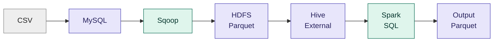

# E-Commerce Sales Data Pipeline and Analysis Using Spark SQL

## 1) Project Introduction

This project demonstrates an end-to-end e-commerce Big Data pipeline where transactional sales data is processed and analyzed using Spark SQL.

The complete pipeline is:

**CSV --> MySQL --> Sqoop --> Hadoop HDFS --> Hive External Tables --> Spark SQL --> Output (Parquet)**

### Architecture



## 2) Problem Statement

The objective of this project is to build an end-to-end data pipeline for e-commerce transactional data and perform business-oriented sales analysis.

The pipeline takes raw CSV data, loads it into MySQL, transfers the data to HDFS using Sqoop in Parquet format, creates Hive External Tables on the Parquet data, and uses Spark SQL for joins and analysis.

## 3) Dataset

The project uses five transactional CSV datasets:

- `customers.csv`
- `orders.csv`
- `order_items.csv`
- `products.csv`
- `payments.csv`

The datasets contain customer information, order details, product information, order items, and payment transactions.

**Dataset size:** ~99K orders, ~112K order items, ~99K customers, ~33K products and ~104K payment records.

**Note:** Raw CSV files are not included in this repository due to size. The dataset is the public Olist Brazilian E-Commerce dataset (available on Kaggle). Product category names are in Portuguese (for example, `beleza_saude` = health and beauty).

## 4) Technologies Used

- Linux
- MySQL
- Sqoop
- Hadoop HDFS
- Hive
- Apache Spark SQL
- PySpark
- Parquet

## 5) Project Workflow

### Step 1: Load CSV Data into MySQL

The raw CSV files are loaded into MySQL tables using `LOAD DATA LOCAL INFILE`.

### Step 2: Transfer Data Using Sqoop

Sqoop is used to import the MySQL tables into HDFS in Parquet format.

### Step 3: Store Data in HDFS

The imported Parquet files are stored in HDFS under separate directories for each table.

```text
Base: hdfs://localhost:9000/user/aaqib/input_projects/2_ecommerce_transactional/

├── customers_parquet
├── products_parquet
├── orders_parquet
├── order_items_parquet
└── payments_parquet
```

### Step 4: Create Hive External Tables

Hive External Tables are created on the Parquet data stored in HDFS.
The Hive database and all external tables are created using:

```text
hive/hive_external_parquet_tables.hql
```

The script creates the `ecommerce_sales` database and five external Parquet tables:

- `customers`
- `products`
- `orders`
- `order_items`
- `payments`

The external tables point to the corresponding Parquet directories in HDFS.
The Hive script can be executed using:

```bash
hive -f hive/hive_external_parquet_tables.hql
```

### Step 5: Process Data Using Spark SQL

Spark is configured with Hive support, and Spark SQL is used to read the Hive External Tables, join the tables, and perform business analysis.

All five Hive tables are cached in memory (`CACHE TABLE`) before running the analysis queries, so they are not re-read from HDFS for every query.

### Step 6: Store Analysis Output

Three analysis results are stored in HDFS in Parquet format:

```text
hdfs://localhost:9000/user/aaqib/output_projects/2_ecommerce_transactional/top_categories_parquet
hdfs://localhost:9000/user/aaqib/output_projects/2_ecommerce_transactional/state_wise_sales_parquet
hdfs://localhost:9000/user/aaqib/output_projects/2_ecommerce_transactional/monthly_sales_parquet
```

## 6) Your Role

I worked on the complete data pipeline, including:

- Created MySQL database schemas.
- Loaded CSV data into MySQL.
- Imported MySQL tables into HDFS using Sqoop.
- Stored the data in Parquet format.
- Created Hive External Tables on the Parquet data.
- Created and managed the Hive database and external table definitions using a Hive `.hql` script.
- Connected Spark with Hive.
- Wrote Spark SQL queries for joins and analysis.
- Cached frequently used tables with `CACHE TABLE`.
- Generated and stored the final output in Parquet format.

## 7) Data Quality Checks

Before running the analysis, the following checks were performed using Spark SQL on the Hive External Tables:

- Row count of each table
- Null value check on key columns (`order_id`, `customer_id`)
- Duplicate check on `order_id`
- Orphan record check (`order_items` without a matching product)


**Findings:**

| Table | Row Count |
|-------|-----------|
| customers | 99,441 |
| products | 32,951 |
| orders | 99,441 |
| order_items | 112,650 |
| payments | 103,886 |

- No null values in `order_id` and `customer_id`
- No duplicate `order_id` values
- No orphan records: every `order_items` row has a matching product, so joins are consistent

## 8) Analysis / Results

The project performs the following analyses using Spark SQL joins, aggregations, grouping and sorting.

### 8.1 Top Product Categories by Sales


**Insight:** Health and beauty (`beleza_saude`) generates the highest sales at approximately **1.26M**, followed by watches and gifts (`relogios_presentes`) at **1.21M** and bed, bath and table (`cama_mesa_banho`) at **1.04M**. The top 5 categories each generate close to or above **0.9M** in sales, showing that sales are distributed across multiple product categories rather than being dominated by a single category.

### 8.2 State-wise Sales Analysis


**Insight:** Sao Paulo ('SP') leads with about **6.0M** in sales, nearly **2.8×** the second-ranked Rio de Janeiro ('RJ') at **2.14M**. Sao Paulo ('SP'), Rio de Janeiro ('RJ'), and Minas Gerais ('MG') together generate about **10.0M** in sales, showing that sales are strongly concentrated in a few states, especially SP, RJ, and MG.

### 8.3 Payment Type-wise Sales


**Insight:** Credit card dominates with about 12.54M in sales (roughly 78% of total payment value), followed by boleto (bank slip) at about 2.87M (roughly 18%). Voucher and debit card together make up under 4%.

### 8.4 Top Customers by Spending


**Insight:** The top customer spent about 13.7K, around 1.4x the second-highest (about 9.6K). The top 10 customers range from about 4.8K to 13.7K, so no single customer dominates overall revenue.

### 8.5 Monthly Sales Trend


**Insight:** Monthly sales grew steadily from about **138K** in January 2017 to over **1.1M** by early 2018. The peak month was **November 2017**, with about **1.19M** in sales, likely influenced by seasonal shopping such as Black Friday. Sales then remained around **1.0M–1.16M** per month through mid-2018. The 2016 months and September to October 2018 show very low sales because the dataset contains only partial data for those periods.
### 8.6 Order Count by State


**Insight:** São Paulo (SP) has the most orders by far with 41,746, about 42% of all 99,441 orders and roughly 3.2x Rio de Janeiro (RJ, 12,852). Minas Gerais (MG) is third with 11,635. This matches the state-wise sales result, where SP also leads in revenue.

## 9) Challenges

During the project, I faced challenges related to:

- Loading CSV data into MySQL.
- File and path issues.
- Hive schema and data-type compatibility.
- Managing data movement between MySQL, HDFS, Hive, and Spark.
- Managing Hive External Tables and their HDFS locations.
- Timestamp conversion: Sqoop stored date columns as `bigint` (epoch milliseconds) in Parquet, which gave wrong dates (like year 48647) in the monthly trend. Fixed by dividing by 1000 before casting to `TIMESTAMP`.

I solved these issues by checking the source data, table schemas, HDFS paths, Hive table definitions, and Spark SQL queries step by step.

## 10) Project Structure

```text
.
├── docs
│   ├── architecture.md
│   └── screenshots
│       ├── 01_top_categories.png
│       ├── 02_state_wise_sales.png
│       ├── 03_payment_type_sales.png
│       ├── 04_top_customers.png
│       ├── 05_monthly_sales.png
│       ├── 06_order_count_by_state.png
│       └── 07_data_quality.png
├── hive
│   └── hive_external_parquet_tables.hql
├── mysql
│   ├── load_data.sql
│   └── schema.sql
├── spark_scripts
│   └── ecommerce_analysis.py
├── sqoop
│   └── sqoop_import_all.sh
└── README.md
```

## 11) How to Run

### Create Hive External Tables

```bash
hive -f hive/hive_external_parquet_tables.hql
```

### Run Spark Analysis

```bash
spark-submit spark_scripts/ecommerce_analysis.py
```

**Note:** HDFS paths (like `hdfs://localhost:9000/user/aaqib/...`) are specific to my setup. Change them according to your own HDFS user before running.

## 12) Conclusion

This project demonstrates a complete end-to-end Big Data e-commerce pipeline using MySQL, Sqoop, HDFS, Hive, and Spark SQL.

The pipeline moves raw transactional data through different stages, stores the data in Parquet format, creates Hive External Tables on the Parquet data, validates data quality, performs multiple business analyses using Spark SQL, and stores the final analysis output in HDFS.

The project provided practical experience in data ingestion, data transfer, distributed storage, Hive External Tables, Spark SQL processing, table caching, and Parquet-based data storage.

## Author

Aaqib Kakar
