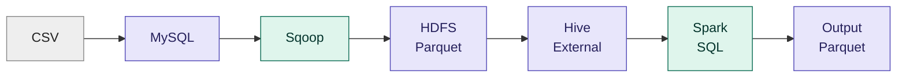
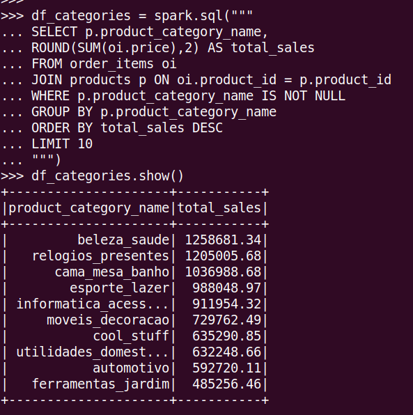
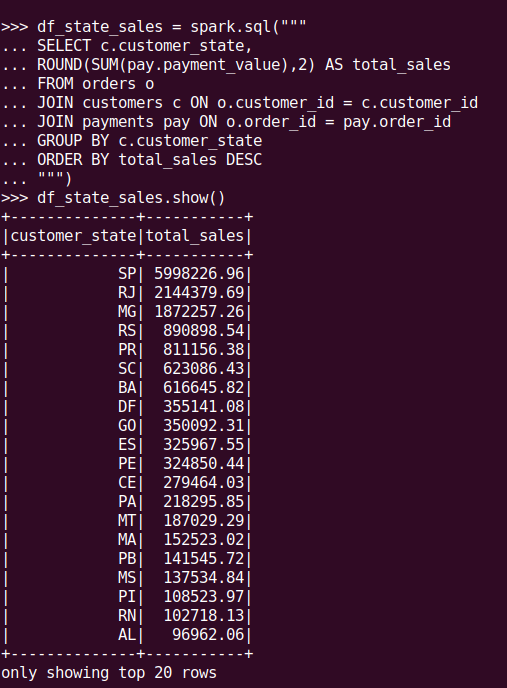
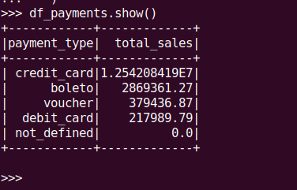
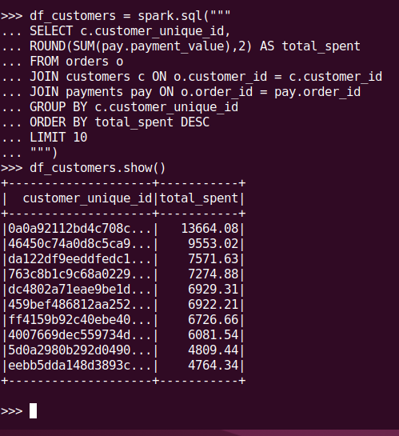
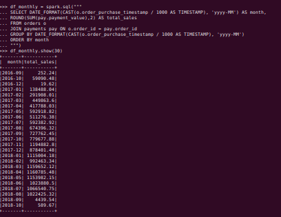
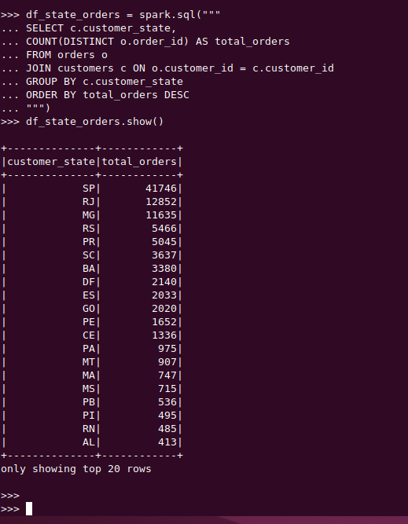

# E-Commerce Sales Data Pipeline and Analysis Using Spark SQL
## 1) Project Introduction
This project demonstrates an end-to-end e-commerce Big Data pipeline where transactional sales data is processed and analyzed using Spark SQL.
The complete pipeline is:

**CSV → MySQL → Sqoop → HDFS (Parquet) → Hive External Tables → Spark SQL → Output (Parquet)**

### Architecture


## 2) Problem Statement
The objective of this project is to build an end-to-end data pipeline for e-commerce transactional data and perform business-oriented sales analysis.
The pipeline takes raw CSV data, loads it into MySQL, transfers the data to HDFS using Sqoop in Parquet format, creates Hive External Tables on the Parquet data, and uses Spark SQL for joins and analysis.

## 3) Dataset
The project uses five transactional CSV datasets:
- `customers.csv`
- `orders.csv`
- `order_items.csv`
- `products.csv`
- `payments.csv`

The datasets contain customer information, order details, product information, order items, and payment transactions.

**Note:** Raw CSV files are not included in this repository due to size.
The dataset is the public Olist Brazilian E-Commerce dataset (available on Kaggle).
Final output is stored in HDFS at `/user/aaqib/output_projects/2_ecommerce/state_wise_sales`.

## 4) Technologies Used
- Linux
- MySQL
- Sqoop
- Hadoop HDFS
- Hive
- Apache Spark SQL
- PySpark
- Parquet

## 5) Project Workflow
### Step 1: Load CSV Data into MySQL
The raw CSV files are loaded into MySQL tables using `LOAD DATA LOCAL INFILE`.

### Step 2: Transfer Data Using Sqoop
Sqoop is used to import the MySQL tables into HDFS in Parquet format.

### Step 3: Store Data in HDFS
The imported Parquet files are stored in HDFS under separate directories for each table.

Example:
```text
Base: hdfs://localhost:9000/user/aaqib/input_projects/2_ecommerce_transactional/

├── customers_parquet
├── products_parquet
├── orders_parquet
├── order_items_parquet
└── payments_parquet
```

### Step 4: Create Hive External Tables
Hive External Tables are created on the Parquet data stored in HDFS.
The Hive database and all external tables are created using:

```text
hive/hive_external_parquet_tables.hql
```

The script creates the `ecommerce_sales` database and five external Parquet tables:
- `customers`
- `products`
- `orders`
- `order_items`
- `payments`

The external tables point to the corresponding Parquet directories in HDFS.
The Hive script can be executed using:
```bash
hive -f hive/hive_external_parquet_tables.hql
```

### Step 5: Process Data Using Spark SQL
Spark is configured with Hive support, and Spark SQL is used to read the Hive External Tables, join the tables, and perform business analysis.

### Step 6: Store Analysis Output
Three analysis results are stored in HDFS in Parquet format:

```text

hdfs://localhost:9000/user/aaqib/output_projects/2_ecommerce_transactional/top_categories_parquet
hdfs://localhost:9000/user/aaqib/output_projects/2_ecommerce_transactional/state_wise_sales_parquet
hdfs://localhost:9000/user/aaqib/output_projects/2_ecommerce_transactional/monthly_sales_parquet

```

### Architecture Flow
**CSV → MySQL → Sqoop → HDFS (Parquet) → Hive External Tables → Spark SQL → Output (Parquet)**

## 6) Your Role
I worked on the complete data pipeline, including:

- Created MySQL database schemas.
- Loaded CSV data into MySQL.
- Imported MySQL tables into HDFS using Sqoop.
- Stored the data in Parquet format.
- Created Hive External Tables on the Parquet data.
- Created and managed the Hive database and external table definitions using a Hive `.hql` script.
- Connected Spark with Hive.
- Wrote Spark SQL queries for joins and analysis.
- Generated and stored the final output in Parquet format.

## 7) Data Quality Checks

Before running the analysis, the following checks were performed using Spark SQL:

- Row count of each table
- Null value check on key columns (order_id, customer_id)
- Duplicate check on order_id
- Orphan record check (order_items without a matching product)


**Findings:** (yahan apne result likho)

## 8) Analysis / Results
The project performs the following analyses:
- Top Product Categories by Sales
  
  
  
- State-wise Sales Analysis
  
  
  
- Payment Type-wise Sales
  
  
  
- Top Customers by Spending
  
  

- Monthly Sales Trend
  
  

- Order Count by State
  
  

Spark SQL was used to perform joins, aggregations, grouping, sorting, and calculations such as total sales and order counts.

## 9) Challenges
During the project, I faced challenges related to:

- Loading CSV data into MySQL.
- File and path issues.
- Hive schema and data-type compatibility.
- Managing data movement between MySQL, HDFS, Hive, and Spark.
- Managing Hive External Tables and their HDFS locations.

I solved these issues by checking the source data, table schemas, HDFS paths, Hive table definitions, and Spark SQL queries step by step.

## 10) Project Structure
```text

.
├── data_sets
│   └── E-commerce_transactional
│       ├── customers.csv
│       ├── order_items.csv
│       ├── orders.csv
│       ├── payments.csv
│       └── products.csv
├── docs
│   ├── architecture.md
│   └── screenshots
│       ├── 01_top_categories.png
│       ├── 02_state_wise_sales.png
│       ├── 03_payment_type_sales.png
│       ├── 04_top_customers.png
│       ├── 05_monthly_sales.png
│       ├── 06_order_count_by_state.png
│       └── 07_data_quality.png
├── hive
│   └── hive_external_parquet_tables.hql
├── mysql
│   ├── load_data.sql
│   └── schema.sql
├── output
│   ├── monthly_sales__parquet
│   │   ├── part-00000-a9c5115e-ef2f-4005-90bf-798be5edd4cc-c000.snappy.parquet
│   │   └── _SUCCESS
│   ├── state_wise_sales_parquet
│   │   ├── part-00000-95af1d19-ca8f-4bbd-81ca-5be551b15cd3-c000.snappy.parquet
│   │   └── _SUCCESS
│   └── top_categories_parquet
│       ├── part-00000-676ca369-e70d-43f5-92e5-145a612b16e0-c000.snappy.parquet
│       └── _SUCCESS
├── README.md
├── spark_scripts
│   └── ecommerce_analysis.py
└── sqoop
    └── sqoop_import_all.sh

```

## 11) How to Run
### Create Hive External Tables
```bash
hive -f hive/hive_external_parquet_tables.hql
```

### Run Spark Analysis
```bash
spark-submit spark_scripts/ecommerce_analysis.py
```

## 12) Conclusion
This project demonstrates a complete end-to-end Big Data e-commerce pipeline using MySQL, Sqoop, HDFS, Hive, and Spark SQL.
The pipeline moves raw transactional data through different stages, stores the data in Parquet format, creates Hive External Tables on the Parquet data, performs multiple business analyses using Spark SQL, and stores the final analysis output in HDFS.
The project provided practical experience in data ingestion, data transfer, distributed storage, Hive External Tables, Spark SQL processing, and Parquet-based data storage.

## Author
Aaqib Kakar
