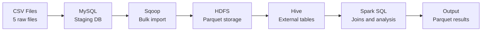

# E-Commerce Sales Data Pipeline Architecture

## 1. Architecture Overview

## 2. Pipeline Stages

### 1. CSV – Raw Data

Five CSV files are used:

- customers.csv
- orders.csv
- order_items.csv
- products.csv
- payments.csv

### 2. MySQL – Data Loading

CSV files are loaded into MySQL tables using `LOAD DATA LOCAL INFILE`.

### 3. Sqoop – Data Transfer

Sqoop imports MySQL tables into HDFS in Parquet format using `--as-parquetfile`.

### 4. HDFS – Data Storage

Parquet data is stored in separate HDFS directories for each table.

### 5. Hive External Tables

Hive External Tables are created on the Parquet data stored in HDFS.

### 6. Spark SQL – Data Processing

Spark SQL reads the Hive External Tables and performs joins, aggregations, grouping, sorting, and business analysis.

### 7. Output

Final analysis results are stored in HDFS in Parquet format.
